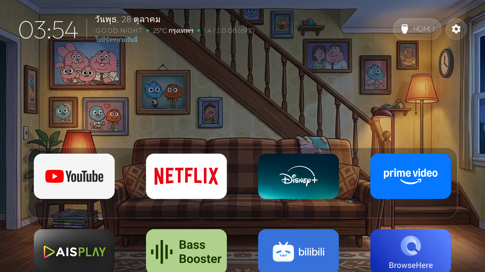
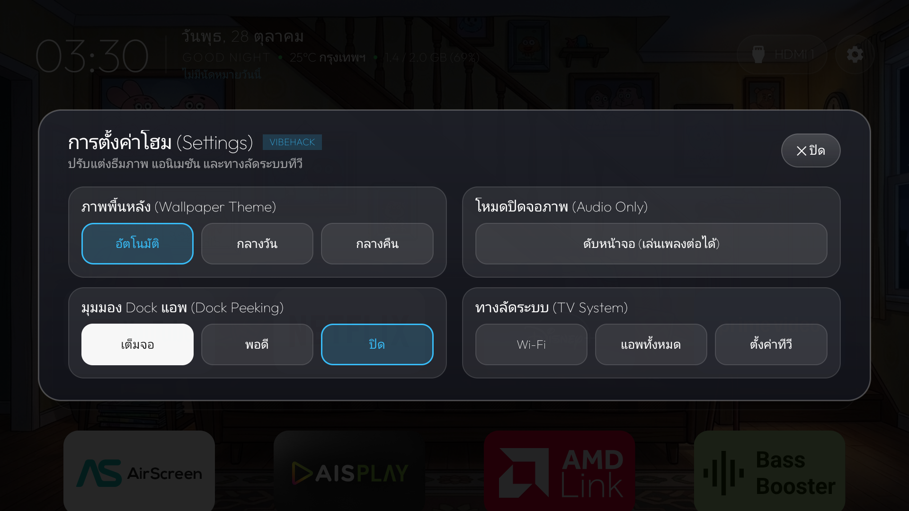

# Android TV Minimal Launcher (tvOS / Apple TV Style)

Launcher สำหรับ Android TV สไตล์มินิมอล คลีนๆ ไม่มีโฆษณากวนใจ ได้แรงบันดาลใจจาก UI ของ Apple TV (tvOS) พัฒนาและทดสอบจริงบน TCL BeyondTV (Android 9 Pie) และรองรับ Android TV ทั่วไป

เน้นความเร็ว กินแรมน้อย แสดงผลภาพพื้นหลังสวยงาม ควบคุมด้วยรีโมททีวีง่าย ไม่มีเมนูซับซ้อน และตัดพวกอีโมจิรกตาออกทั้งหมด

---

## รูปตัวอย่างหน้าจอ (Screenshots)

### หน้าหลัก (Home Screen)
แถบ Island ด้านบนรวมนาฬิกา วันที่ สภาพอากาศ แรม และนัดหมาย พร้อมปุ่มสลับ HDMI และตั้งค่า



### หน้าตั้งค่า (Launcher Settings)
การ์ดควบคุม 2 คอลัมน์สไตล์ Apple TV ปรับแต่งได้ครบทุกอย่างโดยที่เมนูไม่ตกขอบจอ



---

## ฟีเจอร์หลัก (Key Features)

### 1. แถบ Smart Top Bar (ด้านบนซ้าย)
- **นาฬิกาและวันที่:** นาฬิกาตัวเลขบางขนาดใหญ่ (50sp) อ่านง่ายจากระยะโซฟา วันที่ภาษาไทยกดคลิกเพื่อเปิดปฏิทินแบบเต็มเดือนได้
- **สภาพอากาศตามพิกัดจริง:** ตรวจหาพิกัดตาม IP อัตโนมัติและดึงอุณหภูมิเรียลไทม์ผ่าน Open-Meteo API (เช่น `25°C กรุงเทพฯ`) แบบมินิมอลไม่มีอีโมจิ
- **สถานะแรมแบบเรียลไทม์:** แสดงการใช้งานแรมของทีวี เช่น `1.4 / 2.0 GB (70%)` อัปเดตทุกนาที
- **นัดหมายปฏิทินวันนี้:** ดึงตารางงานจากระบบปฏิทินของทีวีมาแสดงบรรทัดเดียว คลีนๆ

### 2. ปุ่มควบคุมและสลับสัญญาณ (ด้านบนขวา)
- **HDMI Quick Switcher:** กดปุ่ม `HDMI 1` เพื่อเปิด Pop-up รายการพอร์ต HDMI / AV สลับช่องสัญญาณได้ในคลิกเดียวโดยไม่ต้องเข้าเมนูทีวีหลายชั้น
- **Now Playing:** แสดงชื่อเพลงที่กำลังเล่นอยู่ (Spotify / เครื่องเล่นเพลง) สามารถกดเปิดแอพเพลงได้ทันที
- **ปุ่ม Settings:** ปุ่มวงกลมขวาสุด เลื่อนรีโมท ซ้าย-ขวา 1 ครั้งสลับกับปุ่ม HDMI ได้แม่นยำ ไม่กระโดดข้าม

### 3. หน้าตั้งค่า Launcher Settings
- **ภาพพื้นหลัง (Wallpaper Theme):** เลือกโหมด `อัตโนมัติ` (สลับภาพกลางวัน/กลางคืนตามเวลาจริง), `กลางวัน`, หรือ `กลางคืน`
- **มุมมอง Dock แอพ (Dock Peeking):** 
  - `เต็มจอ (95%)` ให้ภาพพื้นหลังเด่นชัด แอพจะหลบลงขอบล่างเมื่อไม่ได้ใช้งาน และเด้งขึ้นมาเมื่อกดรีโมทลง
  - `พอดี` แสดงแถบแอพครึ่งจอ
  - `ปิด` ปิดแอนิเมชัน ให้ Dock อยู่กับที่
- **โหมดปิดจอภาพ (Audio Only):** ดับแสงหน้าจอทีวีทันที เหมาะสำหรับเปิดฟังเพลง Spotify หรือ YouTube ทิ้งไว้ก่อนนอน ประหยัดไฟและถนอมจอ กดปุ่มใดๆ บนรีโมทเพื่อเปิดจอกลับมา
- **ทางลัดระบบ (TV System):** ปุ่มลัดเปิด Wi-Fi, รายการแอพทั้งหมด และการตั้งค่าของตัวทีวี

### 4. ซิงค์รายการแอพแบบเรียลไทม์ (Auto App List Sync)
- ฝัง `BroadcastReceiver` สำหรับ `PACKAGE_ADDED` และ `PACKAGE_REMOVED`
- เมื่อถอนการติดตั้งหรือลงแอพใหม่ รายชื่อแอพบนหน้าโฮมจะรีเฟรชตัวเองทันที ไม่ค้างแคชแอพเก่าที่ลบไปแล้ว

### 5. Remap ปุ่มรีโมทฮาร์ดแวร์ (TOT IPTV -> AIS PLAY)
- ทำงานผ่าน `TvAccessibilityService` ในระดับระบบ ดักจับปุ่มลัดฮาร์ดแวร์บนรีโมท (เช่น ปุ่ม TOT IPTV, ปุ่ม TV, Guide, ปุ่มสี) แล้วส่งคำสั่งเปิด **AIS PLAY (`com.ais.mimo.aisplay.tv`)** แทนทันที
- มีโมดูล `tot_forwarder` (`cn.itv.mobile.tv`) ทำหน้าที่ดักจับ Intent ในกรณีที่เฟิร์มแวร์ทีวีพยายามเปิดแอพ TOT IPTV เดิมโดยตรง

---

## โครงสร้างโปรเจกต์ (Project Structure)

```text
├── launcher/               # ตัว Launcher หลัก (Android Leanback TV App)
│   ├── app/                # ซอร์สโค้ด UI, Adapter, AccessibilityService
│   └── build.gradle
├── tot_forwarder/          # โมดูล Forwarder ดักปุ่ม TOT IPTV ไปเปิด AIS PLAY
│   ├── src/
│   └── build.gradle
├── tools/                  # สคริปต์สำรองข้อมูลและ Debloat ทีวีผ่าน ADB
├── docs/                   # รูปภาพประกอบเอกสาร
└── README.md
```

---

## วิธีบิลด์และติดตั้ง (Build & Installation)

### ข้อกำหนด
- JDK 17
- Android SDK (API 28 ขึ้นไป)
- เปิดโหมด **USB Debugging / Network ADB** บน Android TV

### 1. คอมไพล์โปรเจกต์ผ่าน Gradle
เปิด Terminal ในโฟลเดอร์โปรเจกต์แล้วรัน:

```bash
cd launcher
./gradlew assembleDebug
```
*(บน Windows ใช้ `gradlew.bat assembleDebug`)*

จะได้ไฟล์ APK 2 ตัว:
- Launcher: `launcher/app/build/outputs/apk/debug/app-debug.apk`
- TOT Forwarder: `tot_forwarder/build/outputs/apk/debug/tot_forwarder-debug.apk`

### 2. ติดตั้งลงทีวีผ่าน ADB
เชื่อมต่อทีวีผ่าน Wi-Fi หรือสาย USB:

```bash
adb connect <IP_ของทีวี>:5555
adb install -r launcher/app/build/outputs/apk/debug/app-debug.apk
adb install -r tot_forwarder/build/outputs/apk/debug/tot_forwarder-debug.apk
```

### 3. เปิดสิทธิ์การดักปุ่มรีโมท (Accessibility Service)
เพื่อให้ตัว Launcher ดักจับปุ่มทางลัดบนรีโมททีวีได้ ให้รันคำสั่ง:

```bash
adb shell settings put secure enabled_accessibility_services com.gathin.tvhome/com.gathin.tvhome.TvAccessibilityService
adb shell settings put secure accessibility_enabled 1
```

### 4. ให้สิทธิ์อ่านปฏิทิน (สำหรับแสดงนัดหมาย)
```bash
adb shell pm grant com.gathin.tvhome android.permission.READ_CALENDAR
```

### 5. เปิดใช้งาน Launcher
กดปุ่ม Home บนรีโมททีวี แล้วเลือกตั้งค่าให้แอพนี้เป็นหน้าหลัก (Always)
หรือสั่งเปิดโดยตรงผ่าน ADB:

```bash
adb shell am start -n com.gathin.tvhome/.MainActivity
```

---

## การปรับแต่งรายการแอพใน Dock
สามารถแก้ไขลำดับแอพที่ปักหมุดไว้แถวแรกสุด (Dock) ได้ที่ไฟล์:
`launcher/app/src/main/res/values/config.xml`

```xml
<string-array name="dock_apps">
    <item>com.google.android.youtube.tv</item>
    <item>com.netflix.ninja</item>
    <item>in.startv.hotstar.dplus.tv</item>
    <item>com.amazon.amazonvideo.livingroom</item>
</string-array>
```
ใส่ `Package Name` ของแอพที่ต้องการปักหมุดตามลำดับที่ต้องการได้เลย
